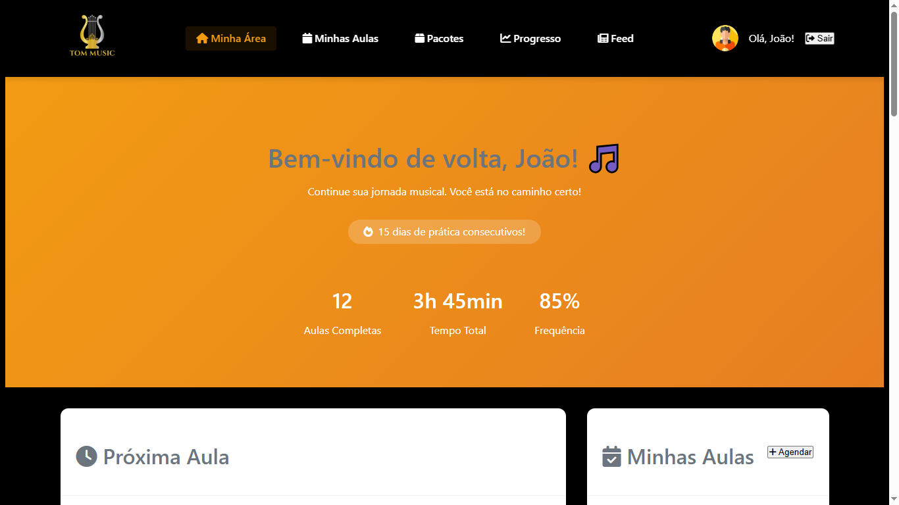
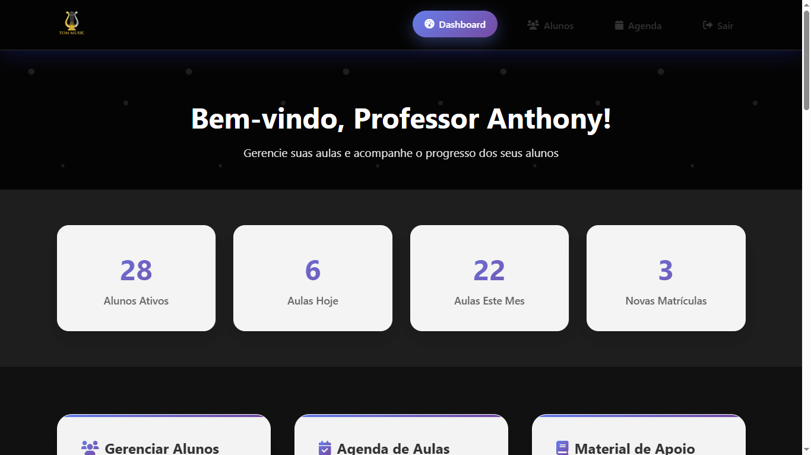

# TRABALHO-FINALWEB
# Tom Music - Escola de Música
### Sumario
- [Sobre o Projeto](#sobre-o-projeto)
- [Objetivos do Projeto](#objetivos-do-projeto)
- [Obs](#Obs)
- [Acesso ao Sistema](#acesso-ao-sistema)
- [Funcionalidades Principais](#funcionalidades-principais)
- [Página Inicial](#página-inicial)
- [Área de Cursos](#área-de-cursos)
- [Seção Social](#seção-social)
- [Sistema de Login](#sistema-de-login)
- [Bibliotecas e API](#bibliotecas-e-api)
- [Estrutura de Arquivos](#estrutura-de-arquivos)
- [Back-end](#back-end)
- [Colaboradores](#colaboradores)
- [Créditos](#créditos)
- [OBS](#OBS)
- [Licença](#licença)

# Sobre o Projeto
Tom Music é o site oficial de uma escola de música moderna, desenvolvido como projeto final da disciplina de Desenvolvimento Web. O site foi projetado para apresentar os serviços, metodologia e corpo docente da escola, com foco em atrair novos alunos e destacar os benefícios de aprender música em um ambiente profissional e acolhedor.

# Objetivos do Projeto

- Criar uma presença digital profissional para a escola de música
- Facilitar o contato entre alunos e professor
- Apresentar de forma atrativa os cursos e metodologias disponíveis
- Implementar um sistema de login por perfil de usuário
- Desenvolver uma interface responsiva e moderna que seja de facil acesso

# Obs : O sistema agora possui back-end (pasta `backend/`). Login, cadastro, agendamento de aulas e cadastro de alunos usam a API; os gráficos e tabelas dos dashboards ainda exibem dados estáticos de demonstração.


# Acesso ao sistema
## **O sistema possui três níveis de acesso diferenciados:**
## ***ADM***

### EMAIL : admin@tommusic.com
### SENHA : admin123
## ***ALUNO***

### EMAIL : joao@email.com
### SENHA : 123456 
## ***PROFESSOR***

### EMAIL : professor@tommusic.com
### SENHA : prof123 

## Funcionalidades Principais
- Navegação Responsiva: Menu de navegação completo com links para as seções principais (Início, Sobre, Pacotes e Login), incluindo menu mobile otimizado
- Design Responsivo: Interface adaptável para desktop, tablet e dispositivos móveis
- Experiência do Usuário: Interface intuitiva e moderna com foco na usabilidade

# Página Inicial

## Seção Hero: Área de destaque com título impactante ("Desperte Seu Talento Musical"), subtítulo informativo e botões de chamada para ação
## Benefícios da Escola: Apresentação dos diferenciais da TomMusic:
- Professor qualificado e experiente
- Aulas personalizadas para cada aluno
- Diversidade de instrumentos disponíveis
- Horários flexíveis para melhor conveniência


# Área de Cursos

- Galeria de Vídeos: Demonstrações do trabalho dos professores em diferentes instrumentos:
- Violão (clássico e popular)
- Teclado 
- Bateria 
- Descrições Detalhadas

# Seção Social

- Depoimentos de Alunos: Área dedicada para testemunhos de alunos satisfeitos
- Credibilidade: Construção de confiança através de experiências reais
- Chamada para Ação: Incentivo para agendamento de aula experimental gratuita

# Sistema de Login

- Autenticação Diferenciada: Sistema com três perfis distintos de usuário
- Interface Segura: Formulário de login responsivo e seguro
- Redirecionamento Inteligente: Direcionamento automático baseado no perfil do usuário

# Bibliotecas e API
- Font Awesome: Biblioteca de ícones moderna e responsiva
- JSONPlaceholder API: Feed básico para simulação de dados dinâmicos

# Estrutura de Arquivos
- index.html              # Página principal
- sobre.html              # Página sobre a escola
- pacotes.html            # Página de pacotes e cursos
- feed.html               # Feed de notícias e atualizações
- gerenciamento.html      # Área de gerenciamento
- mainAdm.html            # Dashboard do administrador
- mainProf.html           # Dashboard do professor
- mainUser.html           # Dashboard do aluno
- styles.css              # Estilos principais
- script.js               # Lógica JavaScript principal


# Back-end

API REST em **Node.js + Express + Prisma + PostgreSQL (Neon)**, que também serve o front-end.

## Requisitos do trabalho x onde estão

| Requisito | Implementação |
|---|---|
| Colaboração via Pull Requests | `.github/pull_request_template.md` + CI (`.github/workflows/ci.yml`) rodando os testes em cada PR |
| Banco de dados (3+ entidades) | `User`, `Instrument`, `Lesson` — `backend/prisma/schema.prisma` |
| Relacionamento 1:N | `Instrument → Lesson`, `User(aluno) → Lesson`, `User(professor) → Lesson` |
| Arquitetura em camadas | `routes → controllers → services → repositories` (`backend/src/`) |
| Testes automatizados | Vitest + Supertest, 45 testes em `backend/tests/` |
| Validação e tratamento de erros | Zod (`validators/`) + middleware global (`middlewares/errorHandler.js`) |
| Upload de arquivos | Foto de perfil: `POST /api/users/:id/avatar` (JPG/PNG/WEBP, até 2 MB) |
| Documentação | Este README + Swagger UI em `/api/docs` |
| Autenticação | JWT + bcrypt, perfis `ALUNO`, `PROFESSOR` e `ADMIN` |
| Deploy público | `render.yaml` (Render + Neon) — veja abaixo |

## Como rodar localmente

```bash
cd backend
cp .env.example .env        # preencha DATABASE_URL (Neon) e JWT_SECRET
npm install
npx prisma db push          # cria as tabelas
npm run db:seed             # cria usuários de demonstração e instrumentos
npm run dev                 # http://localhost:3000
```

Abra `http://localhost:3000` (site) ou `http://localhost:3000/api/docs` (documentação da API).

```bash
npm test                    # testes (não precisam de banco: usam repositórios em memória)
```

## Principais endpoints

| Método | Rota | Acesso |
|---|---|---|
| POST | `/api/auth/register` | Público (cria sempre um ALUNO) |
| POST | `/api/auth/login` | Público |
| GET | `/api/auth/me` | Autenticado |
| GET/POST | `/api/users` | ADMIN (professor lista só alunos) |
| GET | `/api/users/teachers` | Autenticado |
| GET/PATCH/DELETE | `/api/users/:id` | Próprio usuário ou ADMIN (DELETE só ADMIN) |
| POST | `/api/users/:id/avatar` | Próprio usuário ou ADMIN |
| GET | `/api/instruments` | Público |
| POST/PATCH/DELETE | `/api/instruments` | ADMIN |
| GET/POST | `/api/lessons` | Autenticado (cada perfil vê só as suas aulas) |
| GET | `/api/lessons/availability?teacherId=&date=` | Autenticado |
| PATCH | `/api/lessons/:id` | Participantes da aula / ADMIN |
| DELETE | `/api/lessons/:id` | ADMIN |

Regras de negócio: horários de 08:00 a 18:00 (de hora em hora), sem agendar no passado, sem conflito de horário para o professor ou para o aluno (HTTP 409), aluno só pode cancelar a própria aula.

## Deploy (Render + Neon)

1. Crie um banco no [Neon](https://neon.tech) e copie a `DATABASE_URL`.
2. No [Render](https://render.com), crie um **Blueprint** apontando para este repositório (usa `render.yaml`).
3. Defina `DATABASE_URL` nas variáveis de ambiente (o `JWT_SECRET` é gerado automaticamente).
4. Após o deploy, **troque as senhas dos usuários de demonstração** (admin123, prof123, 123456).

> Observação: no plano gratuito do Render o disco é efêmero, então as fotos enviadas somem a cada novo deploy/reinício. Para produção real, use um armazenamento externo (S3, Cloudinary etc.).

## Fluxo de trabalho em equipe

Branch por tarefa (`git checkout -b feature/nome`) → commits → Pull Request para `main` → pelo menos uma revisão → merge com os testes do CI verdes.

# Colaboradores
### Este projeto foi desenvolvido por:

- ScrumMaster/ ProductOwner e Usuario  : Anthony Guimaraes
- Desenvolvido por [Helberth Renan , Caio César].

# Créditos
### Para desenvolvimento da API 
- https://arthurporto.notion.site/09-API-REST-f68bf87b73be448e99171e195f53dbd0
- https://jsonplaceholder.typicode.com/guide/
- https://jsonplaceholder.typicode.com/

### OBS: E DE SUMA IMPORTANCIA QUE TAMBEM FIZEMOS SIM O USO DE INTELIGENCIA ARTIFICIAL PARA NOS AUXILIAR EM FUNCAO DE USO EM ALGUMAS TAGS DIVS, E EM PARTES DA IMPLEMENTACAO DO JS  QUE NAO SABIAMOS IMPLEMENTAR CORRETAMENTE .

# Licença
Este projeto é de uso livre e está licenciado sob a [MIT License](https://opensource.org/licenses/MIT).


